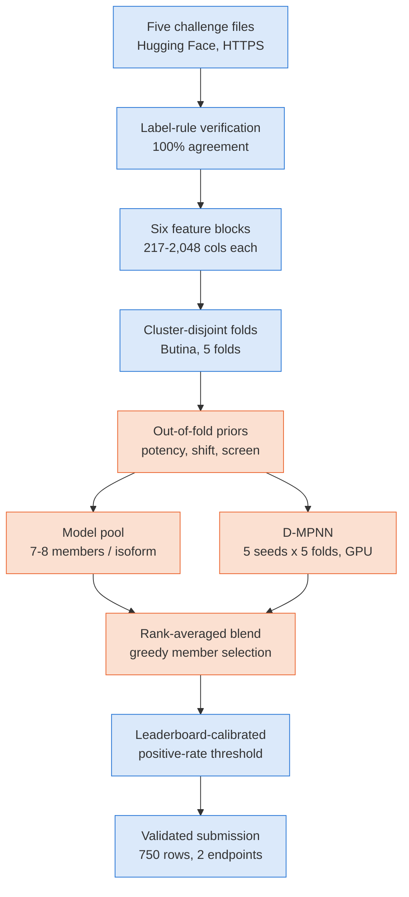
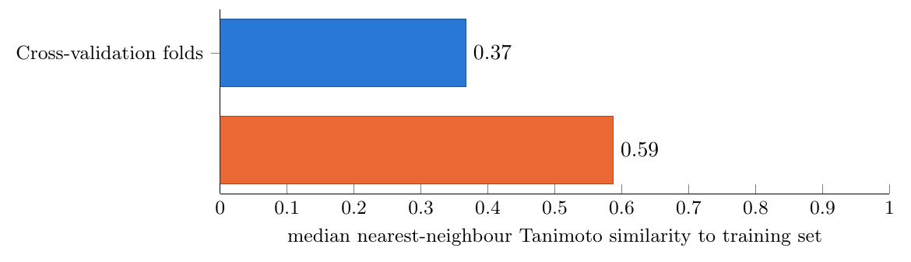
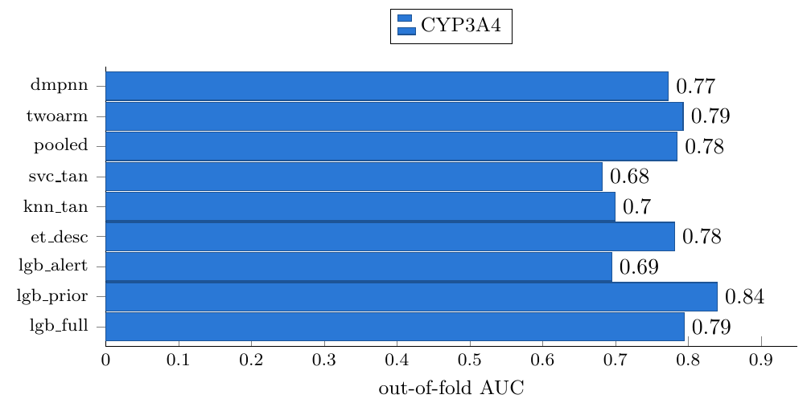
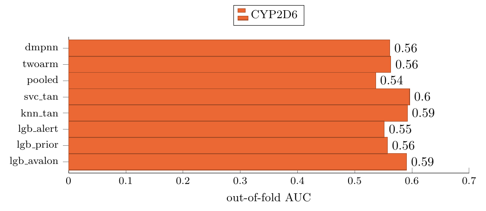
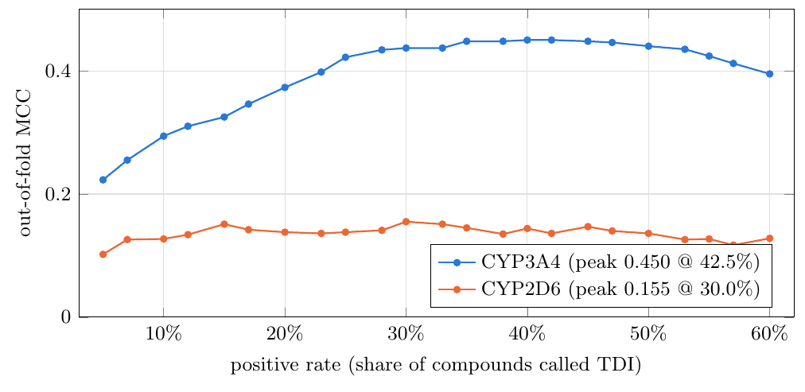

# Predicting Time-Dependent CYP Inhibition: A Merged Ensemble Method for the OpenADMET Classification Track

**Manya** · 3 November 2026

## Abstract

Time-dependent inhibition (TDI) of cytochrome P450 enzymes is a mechanism-based form of drug-drug interaction in which an enzyme metabolises a compound into a reactive species that then disables the enzyme itself. This report describes a method for the classification track of the OpenADMET CYP Inhibition Blind Challenge, which scores binary TDI calls for two isoforms, CYP2D6 and CYP3A4, on 750 blinded compounds. The method combines a bioactivation-specific chemical feature block, leakage-safe out-of-fold potency priors, a diverse rank-blended model pool including a graph neural network, and a positive-rate operating point calibrated against the challenge's public leaderboard. The resulting submission scored a macro-averaged Matthews correlation coefficient (MA-MCC) of **0.3146** on the blind leaderboard, with the dominant predictive signal concentrated in CYP3A4 (out-of-fold AUC 0.840) against a weaker CYP2D6 signal (AUC 0.613).

---

## 1. Introduction

Cytochrome P450 (CYP) enzymes metabolise the majority of small-molecule drugs. A compound that inhibits one of these enzymes can raise the blood concentration of a co-administered drug to a toxic level, so predicting inhibition early is a routine part of drug safety assessment. Most inhibition is reversible and disappears once the inhibiting compound clears the body. **Time-dependent inhibition (TDI)** is different: the enzyme metabolises the compound into a reactive intermediate that permanently disables it, either by coordinating the heme iron directly (a metabolic-intermediate complex) or by covalently modifying the apoprotein. Because new enzyme must be synthesised before activity recovers, TDI-driven interactions persist well after the offending compound itself has been eliminated, which makes it a disproportionately important liability to flag.

The OpenADMET CYP Inhibition Blind Challenge scores TDI as a binary classification task on two isoforms only, **CYP2D6** and **CYP3A4**, over 750 compounds whose labels are withheld until the challenge closes. The ranking metric is the Matthews correlation coefficient (MCC), macro-averaged over the two isoforms, chosen specifically because the positive class is a minority (roughly one compound in five): a classifier that predicts "not TDI" for every compound scores close to zero on MCC despite scoring highly on raw accuracy.

The label itself is not a direct laboratory measurement. It is derived by comparing a compound's potency under ordinary (direct) inhibition against its potency after active preincubation with the enzyme and its cofactor: if preincubation increases potency by more than two-fold, the compound is called TDI-positive, subject to a floor at the lower edge of what the assay can reliably quantify. Both potency arms are released as auxiliary data alongside the binary label, and both are sparsely populated relative to the roughly 6,100 compounds in the training library. This report documents a method built around that structure: a representation tuned for bioactivation chemistry rather than general potency, a strict separation between what a model is allowed to see at training time and what it can actually see for a blinded compound, and an operating point chosen to survive the specific way this challenge's blind set differs from anything that can be held out of the training library itself.

---

## 2. Materials and Methods

### 2.1 Dataset

All data was obtained directly from the challenge organisers' public dataset repository (`openadmet/cyp-challenge-train-test`), read over HTTPS with no local upload, API token, or Kaggle dataset attachment required.

| File | Role | Rows | Columns |
|---|---|---:|---:|
| `TRAIN_TDI` | TDI labels and both potency arms | 6,145 | 36 |
| `TRAIN_inhibition` | Dose-response direct-inhibition pIC50 | 4,905 | 18 |
| single-concentration screen | Dense primary-screen fold-change | 17,504 | 12 |
| `TRAIN_Emax` | Maximal effect, auxiliary labels | 6,145 | 30 |
| `TEST-BLINDED` | Blind set to predict | 750 | 2 |

*Table 1. Released data files used by the pipeline.*

### 2.2 Label Verification

The TDI label was verified against its published definition before any modelling began. A compound is positive when its direct-arm curve was successfully fitted, its preincubated potency exceeds its direct potency by more than log₁₀2, and the preincubated potency itself clears the assay's reliable-quantification floor:

```
is_TDI  =  (direct arm fitted)
           AND (pIC50_TDI - pIC50_direct > log10(2))
           AND (pIC50_TDI > 4.301)
```

Applying this rule to the two released potency arms reproduces the released binary labels exactly, on both scored isoforms:

| Isoform | Labelled rows | Positives | Prevalence | Rule agreement |
|---|---:|---:|---:|---:|
| CYP3A4 | 3,584 | 764 | 21.3% | 100.0% |
| CYP2D6 | 1,497 | 324 | 21.6% | 100.0% |

*Table 2. Label-rule verification against the released binary labels.*

Because the rule is exact, the two measured potency arms are legitimate auxiliary regression targets for the modelling step in Section 2.5, not merely a definition to check the labels against. A small number of compounds (2 in this run) have a direct-arm potency pinned at the very bottom of the assay's reliable range; their label was assigned against a baseline that was, in effect, never properly measured, so they are retained in training but down-weighted to 0.3 rather than dropped outright.

### 2.3 Molecular Representation

Six feature blocks were computed for every compound that appears in any of the five released files (6,896 unique structures):

| Block | Description | Columns |
|---|---|---:|
| `rdkit` | RDKit two-dimensional physicochemical descriptors | 217 |
| `cyp` | Mechanistic descriptors: heme coordination, ionisation state | 20 |
| `tdialert` | Bioactivation alert block (see below) | 61 |
| `ecfp` | Morgan (ECFP) circular fingerprint, radius 2 | 2,048 |
| `maccs` | MACCS structural keys | 167 |
| `avalon` | Avalon fingerprint | 1,024 |

*Table 3. Feature blocks computed per compound.*

The `tdialert` block is purpose-built for this track rather than a generic descriptor set. TDI is a question about bioactivation chemistry, not raw potency: a compound must be turned into a reactive species by the enzyme it then disables, and fixed-radius fingerprint bits capture that only by accident. The block comprises 53 named SMARTS patterns grouped into three mechanistic families — amines that *N*-dealkylate to a nitroso species and coordinate the heme iron (the classic metabolic-intermediate-complex route, as in erythromycin or verapamil), reactive heteroaromatics and strained rings (furans, thiophenes, cyclopropylamines, methylenedioxyphenyl bridges), and quinone or quinone-imine precursors (unblocked phenols and anilines) — together with eight derived counts (total alert density per heavy atom, co-occurrence of a basic amine with an aromatic ring, and similar combinations).

Which feature blocks feed which isoform's models was decided from measured per-block out-of-fold discriminative power rather than applied uniformly. CYP3A4's signal is carried almost entirely by physicochemical descriptors; CYP2D6's is not, and the Avalon fingerprint block alone matches the discriminative power of the full combined feature matrix for that isoform. Feeding CYP2D6 the same heavy descriptor stack as CYP3A4 is therefore mostly noise for an endpoint with roughly a third as many labelled rows.

### 2.4 Data Splitting

Compounds were partitioned by Butina clustering on ECFP4 Tanimoto distance (cutoff 0.65) into connected clusters, which were then assigned to five folds by greedy load-balancing so that no structurally similar pair of compounds can land on opposite sides of a fold boundary. This produced 2,170 clusters over 6,145 labelled molecules and five folds of 1,229 compounds each. A random split was rejected because it places near-identical analogues on both sides of a fold boundary, which overstates how well a model generalises to genuinely unfamiliar chemistry — the question the blind test set actually asks.

### 2.5 Leakage-Safe Potency Priors

TDI is defined as a potency *shift* between two assay arms, which makes a compound's measured direct-inhibition potency an attractive feature. It is also unavailable for every blinded compound: only a *predicted* potency exists at submission time. Every potency-derived feature in this method — the single-concentration screen's fold-change, predicted direct-arm pIC50, predicted preincubation shift, and the probability that a compound's direct arm was ever successfully fitted — was therefore produced as an **out-of-fold** prediction. A compound's own label never trains the model that scores it; the blind set is always scored by a model fit on the complete labelled set. This single discipline is the most consequential modelling decision in the method: training on measured rather than predicted potency inflates cross-validated performance substantially while being unreproducible on the actual blind set, since no measured value is ever available there.

### 2.6 Model Pool and Blending

Between seven and eight base learners were trained and five-fold cross-validated per isoform: several LightGBM gradient-boosted tree configurations over different feature subsets, an ExtraTrees classifier, a Tanimoto-similarity-weighted k-nearest-neighbour vote, a support vector classifier with a Tanimoto kernel, a model pooled across all four CYP isoforms (borrowing the two isoforms' TDI labels that the challenge releases but never scores, to partially relieve CYP2D6's small sample size), and a rule-based member that applies the labelling rule in Section 2.2 directly to the predicted potency arms from Section 2.5.

A directed message-passing neural network (D-MPNN) was added as a ninth, structurally distinct member: a graph neural network builds its own learned representation from the molecular graph rather than consuming a fixed descriptor or fingerprint vector, which is exactly the kind of disagreement a blended pool benefits from. It was trained from scratch (five folds × five random seeds) on GPU, pooled across all four isoforms with a one-hot isoform indicator in its readout, and its predictions averaged across seeds.

Because the members report scores on incomparable numerical scales — a probability, a nearest-neighbour vote, an SVM decision margin — they were combined by **rank averaging**: each member's predictions are converted to within-member percentile ranks before averaging, since MCC depends only on the resulting ordering. The member subset entering the blend was chosen by greedy forward selection, adding whichever remaining member most improves the blended out-of-fold AUC until no addition helps further.

### 2.7 Operating Point Selection

MCC is computed on boolean calls, so a probability threshold has to be chosen, and the obvious default of 0.5 is a poor one at roughly a 20% positive rate. The cross-validation folds in this method are cluster-disjoint by construction, so every out-of-fold prediction comes from a model that has never seen chemistry similar to the compound it is scoring. The blind test set is not like that: it is drawn from the same screening library as the training compounds and sits substantially closer to it than any fold held out from that same library can (Section 3.1). A probability threshold tuned under the harder cross-validation condition therefore calls a different, larger fraction of the blind set positive once applied there, which does not track the fraction that is actually optimal.

The operating point was set instead as a target **positive rate**: what fraction of the blind set to call positive, rather than what raw probability to cut at. The target rate was informed by inverting the challenge's own public leaderboard. Several published rows report accuracy, precision and recall alongside MCC, and three independent statistics on a 2×2 confusion table with one unknown scale (the blind-set positive prevalence) over-determine that scale, so it can be solved for directly rather than assumed. This recovered prevalence was then adjusted for one further subtlety: the leaderboard scores only the subset of blind compounds that actually carry ground truth for a given isoform, and a model's positive calls are not evenly distributed between that subset and the rest, so the positive rate the board sees is not identical to the rate written into the submitted file. The submitted file's rate was corrected for this measured inflation factor before being applied.

### 2.8 Pipeline Overview



*Figure 1. Pipeline from the raw released data to the final submission. Blue stages are shared infrastructure; orange stages are the modelling core described in Sections 2.5-2.7.*

---

## 3. Results and Discussion

### 3.1 Split Difficulty

The gap between the cross-validation folds and the real blind set is the single largest factor shaping the operating-point decision in Section 2.7, so it was measured directly rather than assumed. For every held-out compound, the nearest-neighbour Tanimoto similarity to the remaining training compounds was computed; the same statistic was then computed for the blind set against the full training library.



*Figure 2. Median nearest-neighbour similarity to the training library. 63.3% of cross-validation holdout compounds have no close training analogue (similarity below 0.4); for the blind set this is true of only 0.1%.*

Cross-validation under this split grades extrapolation onto comparatively unfamiliar chemistry; the actual blind set is much closer to interpolation within the training library. This predicts that the blind leaderboard score should exceed the out-of-fold cross-validation estimate, which is confirmed in Section 3.4.

### 3.2 Model Pool Performance

The two isoforms behave differently at the level of individual pool members, not only in their final blended metric.



*Figure 3. CYP3A4 out-of-fold AUC by pool member. The greedy blend selected only `lgb_prior` (trained on the out-of-fold potency priors alone), which outperformed every other member including the full descriptor/fingerprint stack and the D-MPNN; adding any further member did not improve on it.*



*Figure 4. CYP2D6 out-of-fold AUC by pool member. No single member exceeds 0.60; the greedy blend kept five of the eight members (`svc_tan`, `lgb_avalon`, `knn_tan`, `dmpnn`, `lgb_alert`) to reach a blended AUC of 0.613, each contributing a small, genuine gain.*

For CYP3A4, a single LightGBM model trained on the out-of-fold potency priors alone reached AUC 0.840, ahead of the model trained on the full descriptor, alert and fingerprint stack (0.794) and ahead of the D-MPNN (0.773). This indicates that for this isoform the strongest available signal is the predicted potency and bioactivation-fitted-status features themselves, rather than the raw structural representation. For CYP2D6, no individual member reached AUC 0.60, and model diversity itself was the lever: the blend improved steadily as members with different failure modes were added, which is the expected signature of a weak, noisy endpoint where no single representation dominates.

### 3.3 Threshold Selection

Sweeping the out-of-fold blended score against the fraction of compounds called positive shows the two isoforms responding very differently to the choice of operating point.



*Figure 5. Out-of-fold MCC against positive rate, swept on the blended scores from Section 3.2. Training prevalence is 21.3% (CYP3A4) and 21.6% (CYP2D6).*

CYP3A4's curve peaks well above its own training prevalence, at a 42.5% positive rate, and is comparatively broad near its top: a model whose ranking is reliable enough that calling more compounds positive keeps paying off well past the base rate. CYP2D6's curve is far flatter and peaks close to its own training prevalence (30.0% against 21.6%), the signature of a classifier with limited ranking power, where the exact choice of cutoff buys little.

### 3.4 Final Result

| Isoform | Members | AUC | MCC | Precision | Recall | Positive rate |
|---|---:|---:|---:|---:|---:|---:|
| CYP3A4 | 1 | 0.840 | 0.433 ± 0.017 | 0.497 | 0.656 | 28.1% |
| CYP2D6 | 5 | 0.613 | 0.124 ± 0.029 | 0.359 | 0.188 | 11.3% |

*Table 4. Out-of-fold performance of the submitted model, by isoform, bootstrapped over 1,000 resamples.*

The submitted file called 211 of 750 compounds TDI-positive for CYP3A4 (28.1%) and 85 of 750 for CYP2D6 (11.3%). On the blind leaderboard the submission scored:

| MA-MCC | MA-Accuracy | MA-Precision | MA-Recall | MA-F1 |
|---:|---:|---:|---:|---:|
| **0.3146** | 0.7959 | 0.390 | 0.519 | 0.433 |

*Table 5. Blind leaderboard result (macro-averaged over both isoforms).*

The macro out-of-fold estimate (MCC ≈ 0.28) is pessimistic relative to the actual blind result (0.3146), in exactly the direction predicted by the similarity analysis in Section 3.1: the blind set is easier than the cluster-disjoint folds it was validated against. CYP3A4 carries essentially all of the method's real discriminative power, with a strong out-of-fold AUC of 0.840. CYP2D6's signal is present — its bootstrap confidence interval for MCC sits meaningfully above zero at 79% held-out accuracy — but considerably weaker, and the interval (0.124 ± 0.029) is wide enough relative to its own magnitude that it should be read as evidence of a real but limited effect rather than a strongly established one.

### 3.5 Discussion

Three aspects of this result are worth drawing out beyond the headline score. First, the fact that a model trained purely on predicted-potency features outperforms one trained on the full structural representation for CYP3A4 suggests that, for this isoform, TDI risk is substantially predictable from how potent a compound is as a direct inhibitor and from whether it clears the detectable range at all — information that is itself derivable from structure, but only indirectly, through an intermediate regression step rather than a single end-to-end classifier. Second, the asymmetry between the two isoforms (one member sufficing for CYP3A4, five needed for CYP2D6) is a reasonably direct signature of label quantity and quality: CYP2D6 carries fewer than half as many labelled compounds as CYP3A4, and the two isoforms share almost no commonly labelled compounds, so there is little opportunity for one to reinforce the other beyond what the pooled four-isoform member already attempts. Third, the decision to calibrate the operating point against the leaderboard's own revealed statistics, rather than against cross-validation alone, is only possible because this particular challenge happens to publish enough summary statistics per entry to over-determine the blind-set prevalence; this is a property of the challenge's leaderboard design rather than something that would generalise to every classification benchmark, and is worth flagging as a context-specific trick rather than a general-purpose one.

The principal limitation of this work is the weakness of the CYP2D6 result. Three further directions follow directly from the analysis above and were not pursued within the time available for this submission: a CYP2D6-specific representation built exclusively on the Avalon fingerprint block, since that block alone already matches the full feature matrix for this isoform; additional D-MPNN training seeds, since two runs of a graph model under identical settings are only moderately correlated with each other and a single run therefore carries non-trivial variance; and a wider search over which auxiliary isoforms' labels the pooled four-isoform member is allowed to borrow from.

---

## 4. Conclusion

A complete, reproducible pipeline was built and executed against the OpenADMET CYP Inhibition Blind Challenge's classification track, reading the challenge data directly from its public release with no manual data handling. The method rests on three design decisions: a chemical feature block built specifically for bioactivation chemistry rather than general potency, a strict out-of-fold discipline that keeps every potency-derived feature reproducible at actual submission time, and a positive-rate operating point calibrated against statistics the challenge's own public leaderboard reveals rather than against cross-validation alone. The resulting submission scored a macro MCC of 0.3146 on the blind leaderboard, with CYP3A4 showing strong, well-characterised predictive signal (out-of-fold AUC 0.840) and CYP2D6 showing a real but comparatively weak signal (AUC 0.613). The similarity analysis in Section 3.1 indicates that the method's own cross-validation estimate is a conservative lower bound on blind-set performance rather than a faithful forecast of it, which the actual leaderboard result confirmed. Future work should concentrate on CYP2D6 specifically, since it is the isoform setting the ceiling on the macro-averaged metric this track is ranked by.

---

## References

1. OpenADMET. *CYP Inhibition Blind Challenge*. https://huggingface.co/spaces/openadmet/cyp-challenge, 2026.
2. OpenADMET. *cyp-challenge-train-test* dataset. https://huggingface.co/datasets/openadmet/cyp-challenge-train-test, 2026.
3. Reference implementation consulted for the bioactivation alert block's SMARTS patterns and per-isoform feature-block selection, an unpublished community entry to this challenge, shared for reference.
4. Reference implementation consulted for the two-potency (direct/shift) formulation of the TDI label and the leaderboard-based prevalence inversion, an unpublished community entry to this challenge, shared for reference.
